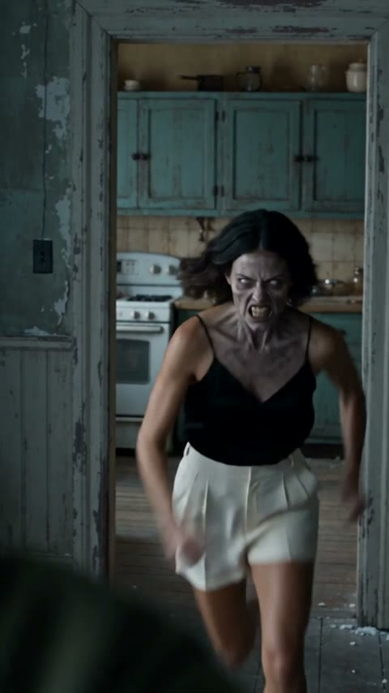

# ZombieHug · AI Zombie Hug Video

  

  <strong>两张照片 → 一段 AI 僵尸拥抱短视频</strong> 
  约 20 秒 · 多镜头 + 音效 · 竖屏 9:16 
  游客可直接支付 · <b>一条 720p $9.99</b> · 无订阅、无需注册

  <em>Sample demo · Seedance 2.5</em> 
  示例成片使用样例演员。你的成片故事相同，但镜头数、动作与相似度会因每次生成而不同。

  
  

---

## 成片分镜

| 1 | 2 | 3 | 4 |
|:---:|:---:|:---:|:---:|
|  |  |  |  |

[▶ 观看演示成片](https://aizombie.app/samples/sample.mp4)

---

## 怎么用

1. 打开 [aizombie.app](https://aizombie.app)
2. 上传两张照片（照片 1 = 举枪；照片 2 = 变僵尸；须为不同的人）
3. 可选填写回忆地点 → Create
4. 游客可用 Stripe 付 **$9.99** 出一条 720p（也有 3-pack / Creator）

---

## 模板

  
  
  

- **Zombie Love Story** — 情侣对峙 → 拥抱（主推）
- **Match Cut** — 卡点转场
- **AI Zombie Trend** — 多镜头趋势款
- **The Last Hug** — 亲子 / 所爱
- **Zombie Cat / Dog** — 你 + 猫狗
- **AI Zombie Video** — 通用成片

---

## 定价

| 套餐 | 价格 | 积分 |
|---|---|---|
| Single | $9.99 | 500 ≈ 1×720p |
| 3-pack | $24.90 | 1500 ≈ 3×720p |
| Creator | $69.90 | 5000 |

480p 约 375 积分（约 $7.49）。无订阅，按条付。

英文营销文案（与官网一致）：*ZombieHug turns two photos into a 20-second video with several shots and sound in vertical 9:16 — one 720p video for $9.99, no subscription, and no sign-up.*

---

## 为什么做这个

短视频平台上「僵尸拥抱 / Love Story」特效很火，但很多站要注册、要订阅。ZombieHug 做成：**打开就能传图，付一单就出片**。

技术：Cloudflare Workers + Seedance 2.5 + Stripe。

---

## Links

- 官网：https://aizombie.app
- 演示视频：https://aizombie.app/samples/sample.mp4
- GitHub Pages：https://xianyu110.github.io/aizombie/

---

## License

Demo media for product showcase. Site © Maynor / xianyu110. Please only upload photos you own or have permission to use.

---

## Blog（自建内容外链）

- [How to make an AI zombie hug video](blog/how-to-make-ai-zombie-hug-video.en.md) · [中文](blog/how-to-make-ai-zombie-hug-video.zh.md)
- [Prompt guide / why two photos must differ](blog/zombie-love-story-prompt-guide.en.md) · [中文](blog/zombie-love-story-prompt-guide.zh.md)
- Live on site: https://aizombie.app/blog
- Machine-readable: https://aizombie.app/llms.txt
